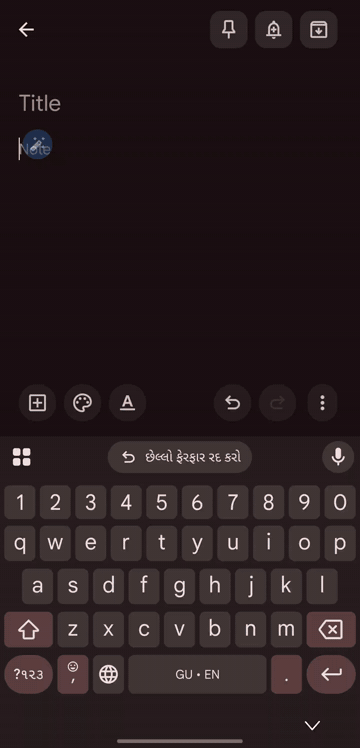
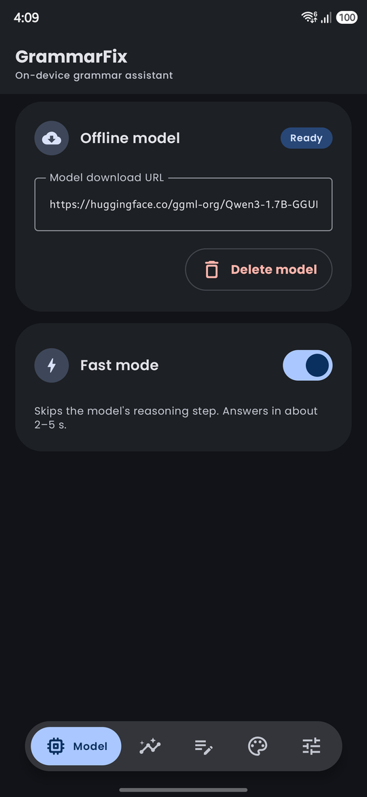
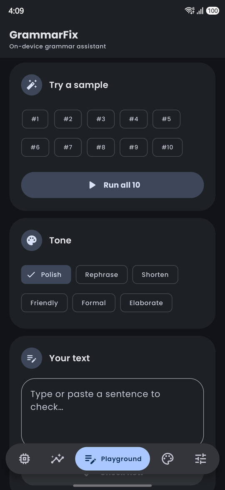
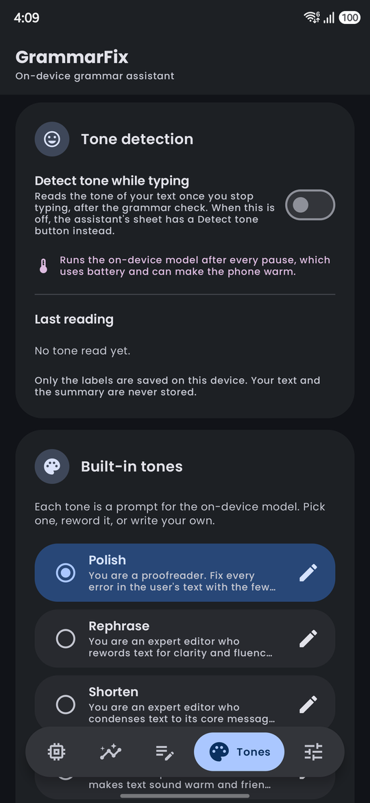
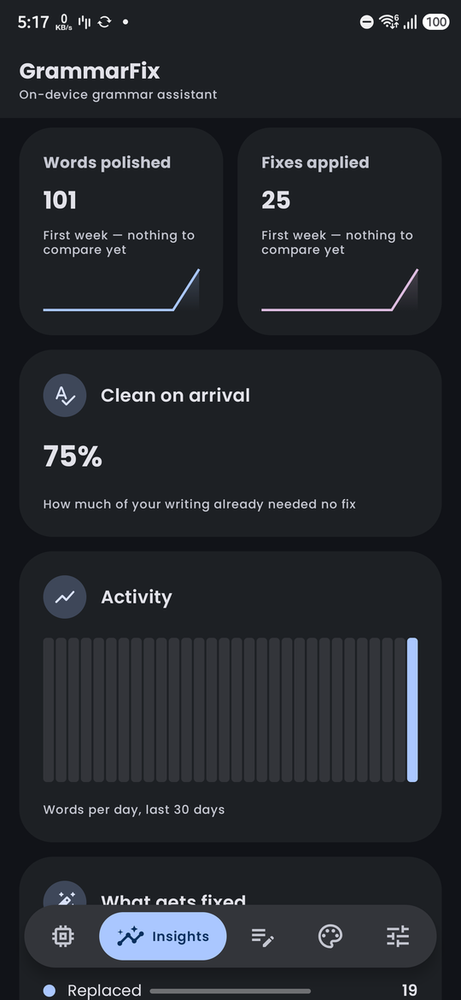
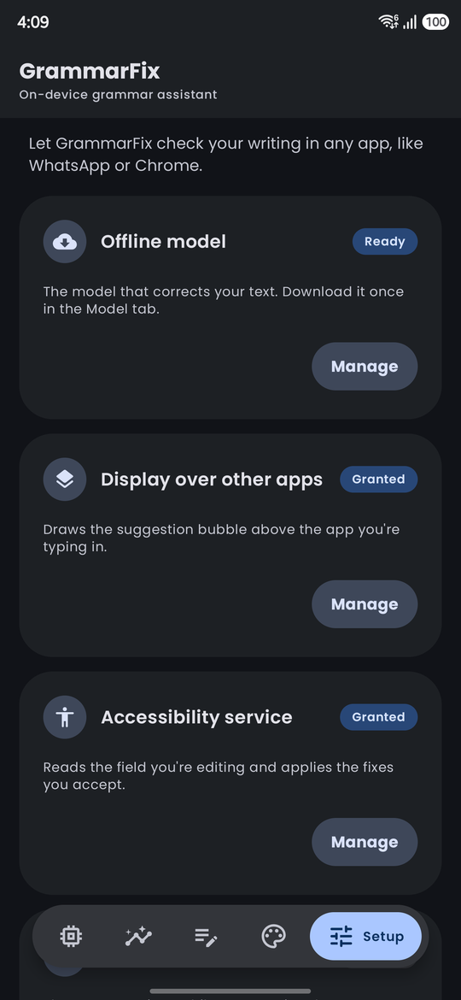

<p align="center"></p>

# GrammarFix

**A Grammarly-style writing assistant that runs entirely on your phone.** GrammarFix checks what
you type in any Android app (Keep, WhatsApp, Chrome, Gmail) and offers fixes in a floating bubble.
Every correction comes from an on-device LLM (Qwen3 GGUF through llama.cpp). There is no server, no
account and no rule table, and your text never leaves the device.

Built with Compose Multiplatform (Kotlin Multiplatform). Android is the full product; iOS runs
the in-app experience.

<p align="center">
  
</p>

---

## ✨ Features

### Fixes in every app

Start the assistant once and keep writing where you already write. GrammarFix reads the field you
are editing through an accessibility service and draws a small bubble above it:

- **Inline suggestions.** Each mistake becomes a card ("Replace ‘buyed’", "Add a word") that you
  accept or dismiss, one at a time or with **Accept all**.
- **Rewrite the whole text** in one tap: polish, rephrase, shorten, make it friendly or formal,
  expand it, or type your own instruction ("Make it sound professional").
- **Undo** the last change, and check just the **selected text** when you only want part of it.

### 🧠 On-device model

| Model |
| --- |
|  |

- Download the Qwen3 model once (about 1.2 GB) from the **Model** tab; it works offline after that.
- **Fast mode** skips the model's reasoning step and answers in about 2–5 seconds. Turn it off when
  you want the slower, more careful answer.
- No network calls on the correction path, no analytics upload, no cloud fallback.

### ✍️ Playground and tones

| Playground | Tones |
| --- | --- |
|  |  |

- **Playground**: paste or type text inside the app and see the corrected version, without
  starting the overlay. Playground runs are never counted in Insights.
- **Tones**: every rewrite style is a prompt for the model. Pick a built-in tone (Polish, Formal,
  Friendly, Shorten, Rephrase, Elaborate), reword it, or write your own. Each tone can allow or skip
  the reasoning step.

### 📊 Insights, kept private

| Insights |
| --- |
|  |

See how your writing is going: words polished, fixes applied, how much text was already clean,
this week against last week, words per day for the last 30 days, and which kinds of fixes you get
(replaced, added, removed words).

Only counts and timestamps are stored. No text you typed, no fixed words and no error messages
are ever written, and a test fails if anyone adds a text column. The data stays in a local Room
database and is never uploaded.

### ⚙️ Guided setup

| Setup |
| --- |
|  |

The **Setup** tab walks through the three things the assistant needs (the model, *Display over
other apps*, and the *Accessibility service*) and then starts or stops the floating assistant.

---

## 🚀 Getting started

Requirements: Android Studio (latest stable), JDK 21, Android NDK (installed by Gradle), and an
Android 8.0+ device with about 2 GB free. A physical device is recommended; the model is slow on an
emulator.

```bash
git clone --recurse-submodules https://github.com/raghavsatyadev/GrammarFix.git
cd GrammarFix
./gradlew :androidCMP:installDebug      # Windows: .\gradlew.bat :androidCMP:installDebug
```

The first build compiles llama.cpp for Android and takes several minutes. Then on the phone:

1. Open **GrammarFix** and download the model in the **Model** tab.
2. In **Setup**, grant *Display over other apps* and the *Accessibility service*.
3. Tap **Start assistant**.
4. Type a sentence with a mistake (for example `She dont like to goes to school.`) in any app and
   tap the bubble.

---

## 🏗️ How it works

```
+--------------------------------------------------------------------------+
|                         composeApp (commonMain)                          |
|  GrammarEngine      on-device LLM corrections (Qwen3 GGUF via llama.cpp)  |
|  SuggestionOverlay  floating pill, suggestion cards, rewrite panel        |
|  GrammarFixApp      Model / Insights / Playground / Tones / Setup tabs    |
|  Room database      tones and privacy-safe correction counts             |
+--------------------------------------------------------------------------+
                 |                                     |
                 v                                     v
+------------------------------------+   +------------------------------+
| androidCMP + llamaAndroid          |   | iosApp                       |
|  GrammarAccessibilityService       |   |  Native host, in-app Compose |
|  FloatingWidgetService (overlay)   |   |  UI and engine               |
|  ACTION_SET_TEXT to apply fixes    |   |                              |
|  llama.cpp JNI (submodule, pinned) |   |                              |
+------------------------------------+   +------------------------------+
```

- **Reading text:** `GrammarAccessibilityService` listens for text-changed and focus events in
  other apps and passes the focused field's text to the engine.
- **Showing fixes:** `FloatingWidgetService` is a foreground service that draws the bubble with
  `TYPE_APPLICATION_OVERLAY`.
- **Applying fixes:** the accepted text is written back with
  `AccessibilityNodeInfo.ACTION_SET_TEXT`.

### iOS

iOS does not let an app draw over other apps or read their text fields, so the system-wide bubble
is Android-only. On iOS the shared Compose UI and engine run inside the app. A custom keyboard
extension (`UIInputViewController` with `textDocumentProxy`) is the way to bring suggestions to
other iOS apps; it is not built yet.

---

## 🛠️ Development

- **Format:** `bash scripts/ci-local.sh --fix` runs the exact ktfmt version CI uses (Google style).
  Don't use a `ktfmt` from your PATH; versions format differently.
- **Local CI:** `bash scripts/ci-local.sh` runs the same ktfmt check and compile as GitHub CI.
- **Screenshot tests:** `./gradlew :androidCMP:validateDebugScreenshotTest`.
- **Git hooks:** `git config core.hooksPath .githooks` blocks commits with unformatted Kotlin.
- **IDE imports:** enable *EditorConfig support* (Settings → Editor → Code Style) so *Optimize
  Imports* matches ktfmt's single, alphabetical import group.
- **Coding agents** (Claude Code, Gemini, Codex, Cursor) start at [AGENTS.md](AGENTS.md), which
  covers the issue-to-PR workflow and on-device verification.
